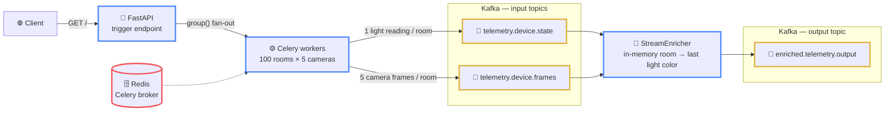
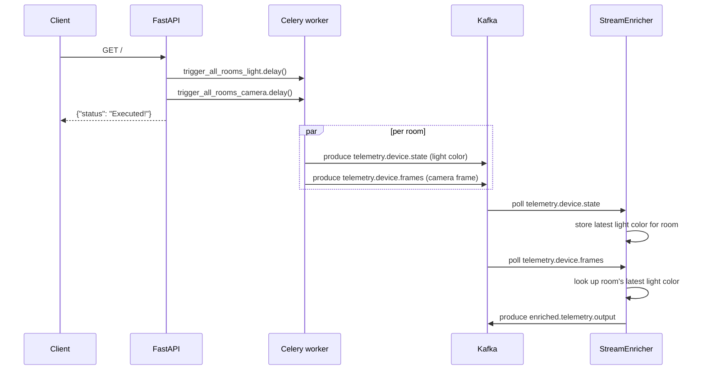

# IoT Observability Pipeline

An event-driven telemetry pipeline that simulates heterogeneous IoT sensors — cameras and
ambient-light sensors across 100 rooms — ingests their readings through **Kafka**, and
correlates the two streams in real time via a **stateful enrichment consumer**, producing
enriched payloads ready for downstream analytics. Built with **Python**, **FastAPI**,
**Celery**, **Apache Kafka**, and **Redis**, orchestrated with Docker Compose.

:::tip[Source code]
[`jecaro094/iot-observability-pipeline`](https://github.com/jecaro094/iot-observability-pipeline)
implements everything described below.
:::

## Architecture

A single FastAPI endpoint fans a trigger out into hundreds of independent Celery tasks, each of
which produces one simulated sensor reading to Kafka. A stateful consumer downstream is the only
component that ever sees both streams together — everything upstream of it is stateless and
independently scalable.



Each trigger fans out to **100 light-reading tasks + 500 camera-frame tasks** (100 rooms × 5
cameras), all dispatched through a single `group()` call — Celery, not the caller, owns the
parallelism.

## Request-to-enrichment flow

The diagram above shows *what* talks to *what*; this one shows the *order* things happen in for a
single room, end to end — which is what actually explains why the enricher needs to hold state at
all: the light reading and the matching camera frame can arrive in either order, seconds apart.



## Running it locally

```bash
git clone https://github.com/jecaro094/iot-observability-pipeline.git
cd iot-observability-pipeline
cp .env.example .env
docker-compose up --build
```

Wait for the `kafka` service's healthcheck to pass — the other four services (`web`, `worker`,
`redis`, `inference-service`) start immediately, but Kafka takes longer to become ready, and
`web`/`inference-service` block on it.

```bash
➜  iot-observability-pipeline git:(main) docker ps
CONTAINER ID   IMAGE                                          COMMAND                  CREATED          STATUS                    PORTS                    NAMES
7472e47baf4a   iot-observability-pipeline-worker              "celery -A src.celer…"   41 seconds ago   Up 40 seconds                                      iot-observability-pipeline-worker-1
0f8bd422e1a9   iot-observability-pipeline-inference-service   "python -m src.consu…"   41 seconds ago   Up 33 seconds                                      iot-observability-pipeline-inference-service-1
a9b9802b9339   iot-observability-pipeline-web                 "uvicorn src.main:ap…"   41 seconds ago   Up 33 seconds             0.0.0.0:80->80/tcp       iot-observability-pipeline-web-1
091a32e64413   redis:7-alpine                                 "docker-entrypoint.s…"   29 minutes ago   Up 40 seconds             6379/tcp                 iot-observability-pipeline-redis-1
dafba529d5e7   apache/kafka:3.9.0                             "/__cacert_entrypoin…"   29 minutes ago   Up 40 seconds (healthy)   0.0.0.0:9092->9092/tcp   kafka

```

Once everything is up, `http://127.0.0.1/docs` serves the FastAPI Swagger UI:


Triggering the endpoint (via Swagger's "Try it out", or `curl http://127.0.0.1/`) dispatches the
Celery fan-out and returns immediately:


## Observing the pipeline

The interesting behavior is in the logs, not the HTTP response — the trigger call returns before
any Kafka message exists.

`docker-compose logs --tail=20 worker` right after a trigger shows the `group()` fan-out actually
dispatching both task types across rooms:

```bash
iot-observability-pipeline-worker-1  | [2026-09-21 12:27:13,319: INFO/ForkPoolWorker-8] Task src.tasks.send_camera_process[f5d7331d-fc44-40cf-aed1-cd2c820d7219] succeeded in 0.12282404199999064s: {'status': 'OK', 'room_id': 'room-98', 'camera_id': 4}
iot-observability-pipeline-worker-1  | [2026-09-21 12:27:13,320: INFO/ForkPoolWorker-7] Task src.tasks.send_camera_process[97d46e29-88bf-4e88-87e9-d3dd316e8fff] succeeded in 0.12272399999997674s: {'status': 'OK', 'room_id': 'room-99', 'camera_id': 3}
iot-observability-pipeline-worker-1  | [2026-09-21 12:27:13,322: INFO/ForkPoolWorker-1] Task src.tasks.send_camera_process[fa492faa-6f35-4d96-9557-b2d9c7d7d06f] succeeded in 0.125651916999999s: {'status': 'OK', 'room_id': 'room-99', 'camera_id': 0}
iot-observability-pipeline-worker-1  | [2026-09-21 12:27:13,324: INFO/ForkPoolWorker-8] [room-99] Sent camera frame: {'roomId': 'room-99', 'cameraId': 4, 'frame': 'fWq82TjQNj7Sk8O2JpLjhQ+XPBf7TAPF+AuzVmEQy5lWcvwt1pmvtmE+vGusSRosZGpNqpDHxuZ/6rqy5xHfiQ==', 'timestamp': '2026-09-21T12:27:13+00:00'}
iot-observability-pipeline-worker-1  | [2026-09-21 12:27:13,436: INFO/ForkPoolWorker-8] Task src.tasks.send_camera_process[6ec28d94-7d3d-46f3-91b9-9e556df15dd2] succeeded in 0.1149470000000008s: {'status': 'OK', 'room_id': 'room-99', 'camera_id': 4}
```

A few seconds later enrichment is shown
— a room's light color being recorded, then a camera frame for that same room being enriched with
it and published downstream:

```bash
iot-observability-pipeline-inference-service-1  | 2026-09-21 12:27:13,424 [__main__] INFO: [ENRICHER] processed room-98/3: {'roomId': 'room-98', 'cameraId': 3, 'frame': 'jnI8YnRSyNIASaOgpgRY50bnYwclRGEIrGRhedU2qONjSa41aXjAMkJbkIUnLH8IA79ePWyKaWRE3hGd3mabEQ==', 'timestamp': '2026-09-21T12:27:13+00:00', 'color': [1.0, 0.7, 0.9]}
iot-observability-pipeline-inference-service-1  | 2026-09-21 12:27:13,424 [__main__] INFO: [ENRICHER] processed room-99/2: {'roomId': 'room-99', 'cameraId': 2, 'frame': 'qwQq7SYmLy7V+CmNpxbrXIRN/Zhk6fXqiKpoCMlApEGAVQGmGaSniIiCY7mK77vj1hMzM2SXbgUzM5OhUlrFGg==', 'timestamp': '2026-09-21T12:27:13+00:00', 'color': [0.0, 0.1, 0.3]}
iot-observability-pipeline-inference-service-1  | 2026-09-21 12:27:13,424 [__main__] INFO: [ENRICHER] processed room-98/4: {'roomId': 'room-98', 'cameraId': 4, 'frame': 'RQ6yg+EYrIfwIuXiFWpERHqqwAR2E5ozk/6AQGXb6iq2bbg60ux7PL/tWXQTYA+jsg3t/p+zyn+EZGXYHJLzUQ==', 'timestamp': '2026-09-21T12:27:13+00:00', 'color': [1.0, 0.7, 0.9]}
iot-observability-pipeline-inference-service-1  | 2026-09-21 12:27:13,424 [__main__] INFO: [ENRICHER] processed room-99/0: {'roomId': 'room-99', 'cameraId': 0, 'frame': 'It/BlBGZE3HVejwYHXPqGCEyrVDPnAZVGDgfUTS/y+dVU4ndEDgxwKn1ngHj2izAWHS7Cyu3dYDOkDBrIg6ajw==', 'timestamp': '2026-09-21T12:27:13+00:00', 'color': [0.0, 0.1, 0.3]}
iot-observability-pipeline-inference-service-1  | 2026-09-21 12:27:13,425 [__main__] INFO: [ENRICHER] processed room-99/1: {'roomId': 'room-99', 'cameraId': 1, 'frame': 'WurnwoMps8CH0F+uVXbP9LP+bQxaiQ4VUpnh/1FqrAslcx46UXU0I+o4sjEuv8QBu+Ll+3mPDpYkmc0bVYu2nw==', 'timestamp': '2026-09-21T12:27:13+00:00', 'color': [0.0, 0.1, 0.3]}
iot-observability-pipeline-inference-service-1  | 2026-09-21 12:27:13,527 [__main__] INFO: [ENRICHER] processed room-99/4: {'roomId': 'room-99', 'cameraId': 4, 'frame': 'fWq82TjQNj7Sk8O2JpLjhQ+XPBf7TAPF+AuzVmEQy5lWcvwt1pmvtmE+vGusSRosZGpNqpDHxuZ/6rqy5xHfiQ==', 'timestamp': '2026-09-21T12:27:13+00:00', 'color': [0.0, 0.1, 0.3]}
```

## Design decisions

| Decision | Why it matters here |
|---|---|
| **Kafka over RabbitMQ** for the sensor streams | The enricher needs to replay/poll two independently-produced topics and correlate them by key (room); Kafka's log-based retention and consumer offsets fit that better than a queue that deletes a message once delivered. |
| **Celery `group()` fan-out** from a single endpoint | Decouples the HTTP request (fast, synchronous) from the actual work (500+ simulated device readings); the caller doesn't wait on Kafka at all. |
| **Stateful, in-memory enrichment** instead of a database | The correlation key space is small (100 rooms) and the "latest value per room" access pattern doesn't need durability across the demo's lifetime — an external store would add an I/O round-trip per message for no benefit at this scale. |

:::note
That last trade-off is also the pipeline's main limitation — see below.
:::

## Configuration

| Variable | Default | Description |
|---|---|---|
| `REDIS_BROKER_URL` | `redis://redis:6379/0` | Celery broker URL |
| `KAFKA_BOOTSTRAP_SERVERS` | `kafka:9092` | Kafka broker address |

Both are loaded from `.env` (git-ignored); `.env.example` is the template.

## Tests

```bash
python -m venv .venv
source .venv/bin/activate
pip install -r requirements.txt
pytest
```

Coverage target is 80%+, covering the two sensor services (`camera_service.py`,
`light_service.py`), the Kafka producer, the Celery tasks, and the exception handling — the
`StreamEnricher` consumer itself is exercised through `test_inference_service.py`.

:::warning[Limitations]
The `StreamEnricher`'s room → light-color map lives in a single process's memory: it is lost on
restart and does not survive running more than one replica of `inference-service` (each would see
only half the streams). The sensors themselves are simulated — there is no real camera or light
hardware, and no schema registry enforcing the shape of what lands on the Kafka topics.
:::
