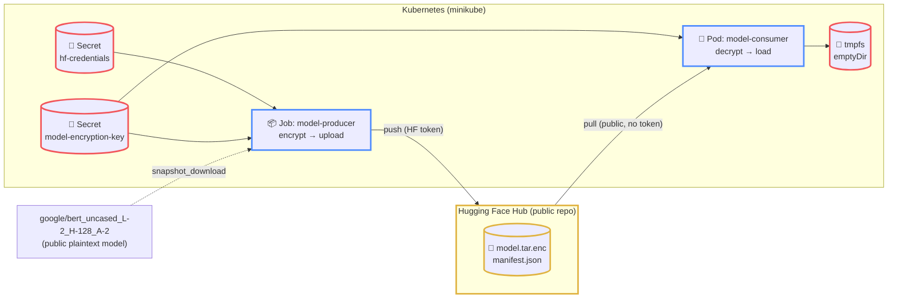
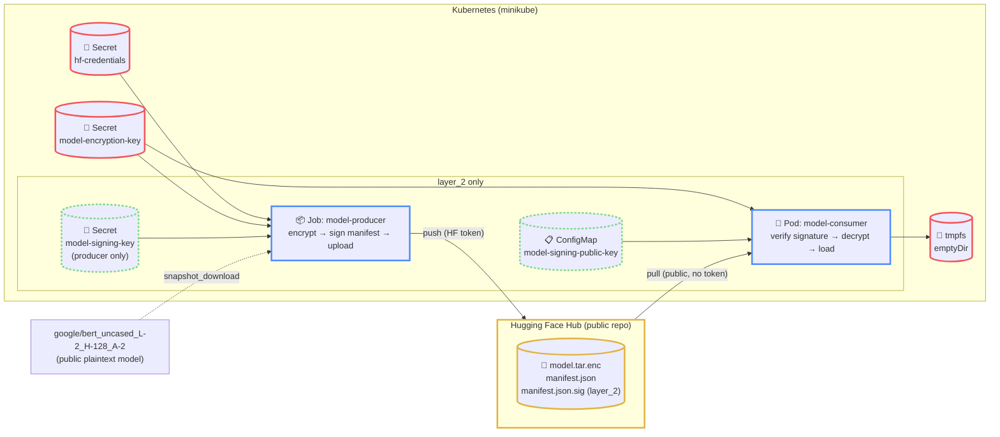
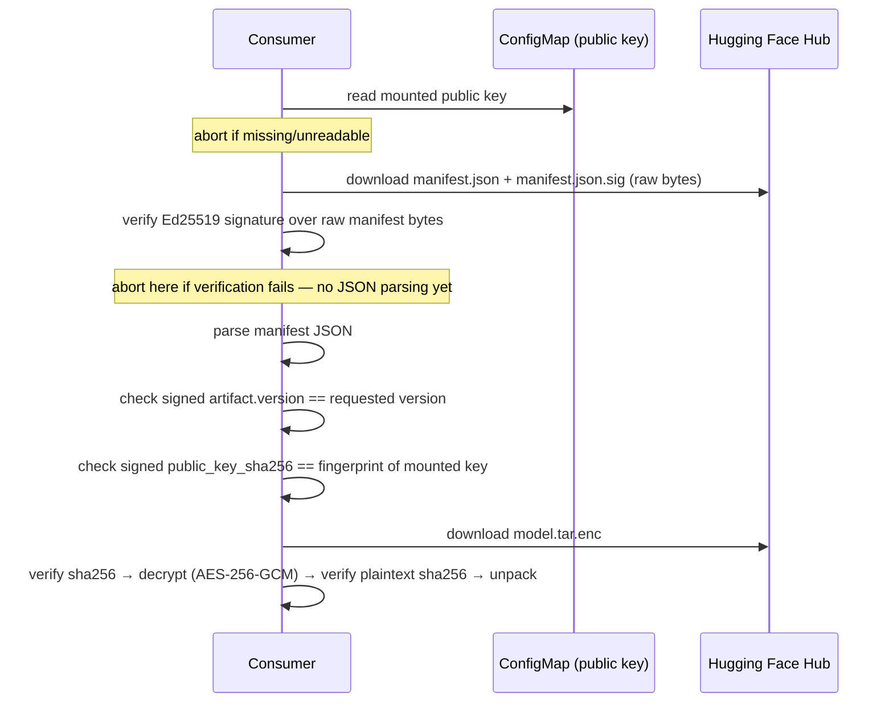

# LLM Delivery Pipeline

A proof of concept for **confidential distribution** of an LLM/ML model through Kubernetes: a
**producer** encrypts a small, open Hugging Face model and publishes the ciphertext to the
Hugging Face Hub, storing the decryption key as a Kubernetes Secret; a **consumer** pod mounts that
Secret, downloads the ciphertext, decrypts it in memory, and loads the model.

:::tip[Source code]
[`main`](https://github.com/jecaro094/llm_delivery_pipeline) implements the mandatory layer
described below. [`layer_2`](https://github.com/jecaro094/llm_delivery_pipeline/tree/layer_2)
branches from it and adds manifest signing and verification — the section
[Layer 2: signing and verification](#layer-2-signing-and-verification) covers exactly what it
changes and why.
:::

## Context

Hugging Face Hub is a convenient, high-availability place to publish a model, but it is also
public — anyone who knows the repo name can download it. The question this repository answers: can
a model be distributed through a public Hub repo without the Hub, or anyone who can read it, ever
being able to reconstruct the plaintext — and can a consumer trust *who* published it?

The underlying exercise defines the problem in layers, and this repository's two branches
implement the first two:

| Branch | Adds | Answers |
|--------|------|---------|
| `main` | AES-256-GCM encryption of the artifact, key delivery via a Kubernetes Secret | *Can the Hub read the model?* No. |
| `layer_2` | Ed25519 signing of the manifest, verification key delivery via a Kubernetes ConfigMap | *Can the consumer tell who published it?* Yes — anyone with repo write access can serve bytes, but only the signing key's holder can make the consumer accept them. |
| *(documented, not implemented)* | Attestation-gated key release (Confidential Containers / Trustee KBS) | *Can the consumer trust the node it's running on?* Not yet — see [What remains open](#what-remains-open-in-both-branches). |

Each layer is independent and additive: `layer_2` does not touch the encrypted container format at
all — it adds a second, parallel guarantee on top of `main`'s confidentiality, rather than replacing
anything.

## Architecture

`main`'s flow, end to end: a producer encrypts and publishes, a consumer downloads and decrypts.



`layer_2` adds exactly two components — a second Secret and a ConfigMap — and two steps inside the
existing Job/Pod, without touching anything else in the picture above:



Note what the second diagram deliberately does **not** show: any arrow from the Hub to the
consumer's public key. `model-signing-public-key` arrives from the cluster only — a public key
fetched from the same repository that serves the artifact would not be a trust anchor at all, since
an attacker able to rewrite the repo could rewrite the key and the signature together, and
verification would degenerate into a self-consistent no-op. That single missing arrow is the entire
mechanism `layer_2` adds.

### Component overview

| Layer | Component | Technology | Role | Branch |
|-------|-----------|------------|------|--------|
| 1 | Producer | Kubernetes Job | Downloads a public model, encrypts it, builds the manifest, publishes it | both |
| 2 | Encryption key delivery | Kubernetes Secret (mounted file) | `model-encryption-key`, mounted read-only, never an env var | both |
| 3 | Signing key delivery | Kubernetes Secret (producer-only mount) | `model-signing-key`, no mount path exists on the consumer's pod spec at all | `layer_2` |
| 4 | Verification key delivery | Kubernetes ConfigMap (mounted file) | `model-signing-public-key` — public by construction, so a ConfigMap rather than a Secret | `layer_2` |
| 5 | Distribution | Hugging Face Hub | Public repo holding the opaque `.enc` artifact, the manifest, and (on `layer_2`) its detached signature | both |
| 6 | Consumer | Kubernetes Pod | Verifies the signature (`layer_2`), mounts the decryption Secret, downloads, verifies hashes, decrypts, loads | both |
| 7 | Decryption target | `tmpfs` `emptyDir` | Memory-backed volume — the plaintext model never touches the node's disk | both |

Two separate container images (producer / consumer) reflect a deliberate split: the producer never
needs `torch`/`transformers`, so it stays small and its attack surface stays minimal; the consumer
needs the full inference stack to run a smoke-test load of the model after decrypting it.

## Encrypted container format

Unchanged by `layer_2` — a deliberate choice that keeps the two cryptographic concerns strictly
separate and every artifact byte-compatible across both branches. It is a small, self-describing
container, not a third-party format, so every field is intentional and inspectable:

```text
+----------------------------------------------------------------+
| magic           "MDLENC\0"                             7 bytes |
| format_version                                          1 byte |
| header_len      uint32 big-endian                      4 bytes |
| header          JSON UTF-8                    header_len bytes |
+----------------------------------------------------------------+
| chunk 0:  uint32 len | ciphertext + GCM tag (16 bytes)         |
| chunk 1:  uint32 len | ciphertext + GCM tag (16 bytes)         |
| ...                                                            |
+----------------------------------------------------------------+
```

The header itself is JSON: 

```json
{
  "format_version": 1,
  "algorithm": "AES-256-GCM",
  "kdf": "HKDF-SHA256",
  "salt": "<16 random bytes, hex>",
  "chunk_size": 4194304
}
```
It is a 4 MiB default chunk size, so the model streams through encryption/decryption instead of ever being loaded whole into memory.

The model is packaged as a **tar before encryption** — one artifact per version keeps the manifest,
upload, and verification simple, and also hides the file names and file count of the model from
anyone who only has the ciphertext. Extraction on the consumer side is path-traversal-safe: member
paths are validated before extraction, rejecting anything absolute or containing `..`.

### Key derivation and authenticated data

The 32-byte master key held in the Kubernetes Secret is never used to encrypt directly:

```text
file_key = HKDF-SHA256(master_key, salt=<16 random bytes, unique per artifact>, info="model-pipeline/v1")
```

Deriving a per-artifact `file_key` lets the container use **deterministic, counter-based nonces**
(`nonce_i = i`, 12 bytes big-endian) safely — every artifact gets its own random salt, so the same
nonce value under two different artifacts never encrypts under the same key, which is what avoids
AES-GCM's classic catastrophic failure mode (nonce reuse under a fixed key leaks the authentication
key outright).

Every chunk is additionally bound to a hash of the header, its own index, and whether it's the
final chunk:

```text
AAD_i = SHA256(header) || uint32_be(i) || (0x01 if last chunk else 0x00)
```

This detects header tampering, chunk reordering, truncation, and cross-artifact chunk mixing — a
chunk decrypted at the wrong index, or as part of the wrong artifact, fails authentication instead
of silently producing a corrupted model.

## Manifest

Published next to the artifact and never carries key material — only a `key_id` **label** (the
name of the Secret), used so the consumer can fail fast on an obvious key mismatch before spending
time decrypting. On `main` the schema is version `1.0`; on `layer_2` it is version `2.0`, which
adds a `signature` section:

```json
{
  "manifest_version": "2.0",
  "artifact": {
    "version": "1.0.0",
    "path": "versions/1.0.0/model.tar.enc",
    "sha256": "<hash of the encrypted file>",
    "plaintext_sha256": "<hash of the plaintext tar>"
  },
  "encryption": {
    "algorithm": "AES-256-GCM",
    "kdf": "HKDF-SHA256",
    "key_id": "model-encryption-key"
  },
  "signature": {
    "algorithm": "Ed25519",
    "public_key_sha256": "<hex SHA-256 of the raw 32-byte public key>",
    "signature_path": "versions/1.0.0/manifest.json.sig"
  }
}
```

- `key_id` is a label, never a hash of the *secret* key — publishing any digest of a secret key
  would hand an offline verification oracle to anyone checking guesses against it.
- `signature.public_key_sha256` is the opposite case: the signing *public* key is public by
  construction, so publishing its hash leaks nothing and is strictly more useful than a name. The
  consumer computes the fingerprint of the key it actually mounted and compares, turning "the
  signature did not verify" into the actionable "you mounted the wrong public key."
- The signature bytes are never a field inside the manifest — a document containing its own
  signature is circular. They live in the detached `manifest.json.sig` file (see below).
- The consumer checks `sha256` **before** decrypting (catches corruption or tampering in transit)
  and `plaintext_sha256` **after** (catches an incorrect or incomplete decryption) — this is
  unchanged from `main`, on top of whatever `layer_2` adds on top.

## Design rationale

:::tip[Why AES-256-GCM, chunked? — main]
GCM is an AEAD — confidentiality and integrity from a single primitive — and benefits from AES-NI
hardware acceleration. Chunking streams the model instead of loading it entirely into memory.
Envelope encryption (DEK/KEK) was considered but adds complexity this layer doesn't need; it's the
natural next step toward attestation-gated key release.
:::

:::tip[Why decrypt onto tmpfs, not disk? — main]
A memory-backed `emptyDir`, with an explicit size limit: the plaintext model is never written to the
node's disk and disappears once the pod terminates. Fully in-memory decryption with no filesystem
would be purer, but the inference library expects file paths to load a model from — tmpfs gets 95%
of the benefit with straightforward code.
:::

:::tip[Why a mounted file, not an env var, for either key? — both]
A mounted Secret file updates automatically on rotation, never appears in `/proc/<pid>/environ`,
and isn't inherited by child processes or captured in crash dumps. Kubernetes mounts Secret volumes
owned by `root` regardless of `defaultMode`, so a non-root container also needs
`securityContext.fsGroup` set to actually read either the encryption key or (`layer_2`) the
verification key.
:::

:::tip[Why is the Hub repo public? — both]
This is the strongest demonstration of the security model — the ciphertext can be public because
**all** of the confidentiality lives in the encryption key, which never leaves the cluster. It also
produces a clean asymmetry: the producer needs a Hugging Face write token, the consumer needs none
at all — true on both branches.
:::

:::tip[Why explicit artifact versioning? — main, built on by layer_2]
Every artifact lives under `versions/<version>/` next to its manifest, and the producer refuses to
overwrite an existing version — published artifacts are immutable. `main` designed the manifest
around this from the start specifically so that, later, one signature over it would be enough —
which is exactly what `layer_2` does.
:::

## Layer 2: signing and verification

`main` proves the artifact wasn't tampered with; it proves nothing about *who* published it,
because the AES-GCM tag only proves the artifact came from someone holding the *encryption* key —
and the consumer holds that same key too. `layer_2` closes exactly that gap with an independent
mechanism: encryption and signing are combined but orthogonal. Encryption without signing gives
confidentiality with no origin authenticity; signing without encryption would give authenticity
with no confidentiality.

### Encrypt, then sign — never the reverse

The producer signs the manifest only *after* the artifact has been encrypted; nothing plaintext is
ever signed. This lets the consumer reject a forged or tampered artifact **without ever invoking
the decryption key** — attacker-controlled bytes are never fed to the AES-GCM decryptor until they
have already been authenticated. It also keeps a standalone `verify` check runnable by a party
holding no decryption key at all (see below).

### The manifest is signed, not the raw artifact bytes

The producer signs the serialized manifest, not `model.tar.enc`. One signature over the manifest
transitively authenticates the artifact *and* every piece of metadata around it (version, source
model, chunk size, plaintext hash), because the manifest already contains `artifact.sha256` over
the encrypted container. Signing only the raw artifact bytes would leave the manifest itself
substitutable — an attacker could keep a genuine, signed artifact and rewrite its recorded
provenance underneath it.

### Why Ed25519

Ed25519 signing is **deterministic** (RFC 8032) — the per-signature nonce is derived from the key
and the message itself, so there is no per-signature randomness to get wrong. This rules out the
failure mode that has repeatedly broken real-world ECDSA deployments: a repeated or predictable
nonce leaks the private key outright. Keys are 32 bytes and signatures 64 bytes — negligible next
to the model artifact — and it adds no new dependency, since the `cryptography` package already
ships in both container images for the AES-GCM path.

### Detached signature, never embedded

The signature is published as its own file, `manifest.json.sig` — 64 raw bytes, no base64 or PEM
wrapping — rather than as a field inside `manifest.json`. A signature embedded in the document it
signs has to define precisely which bytes are excluded from the signed payload, and that
canonicalization question is a recurring source of real-world signature-bypass bugs. Detached
keeps an unambiguous invariant instead: the bytes published as `manifest.json` are byte-for-byte
the bytes that were signed.

### Where each key lives, and why that's the crux of the whole layer

Two new pieces of key material, on two different channels, mounted by two different workloads:

| Key | Delivery | Mounted by | Why |
|-----|----------|-----------|-----|
| Signing **private** key | `model-signing-key` Secret | Producer only — the consumer pod spec has no mount path for it at all | Least privilege per workload (same argument as the encryption key's own Secret). Not having a mount path is a stronger property than "a permission it declines to use": the key material simply cannot be reached from the consumer's pod. |
| Signing **public** key | `model-signing-public-key` **ConfigMap** | Consumer only | Public by definition — storing it as a Secret would misrepresent its sensitivity. |

The public key travels through the **cluster**, never through the Hugging Face repo that also
serves the artifact. This is the one design choice the whole layer stands or falls on: if the
verification key were fetched from the same repository as the artifact, an attacker with write
access to that repo could rewrite the key and the signature together, and verification would
degenerate into checking a document against a key the same attacker also controls — a
self-consistent no-op that verifies nothing.

### Verification order, and failing closed

The consumer verifies **before** parsing the manifest as JSON, before downloading the artifact, and
before reading the decryption key:



Neither cross-check ever *selects* which key or algorithm verifies the signature — both are fixed
by the consumer's own configuration (the mounted public key), and the manifest's own claims about
them are only cross-checked afterwards. Letting a document nominate its own verification method is
the classic `alg: none` / algorithm-confusion bug class; this design avoids it by construction.

The version cross-check closes a partial rollback path: an attacker with repo write access could
otherwise delete a newer version and leave an older, genuinely signed one under the requested name.

There is **no unsigned path**: a missing public key, a missing `.sig` file, a failed verification,
or a manifest whose `manifest_version` predates signing all abort with a non-zero exit. There is no
`--insecure-skip-verify` flag and no silent fallback when a public key isn't configured — a
verification step that can be turned off by a flag or by omitting a file is a downgrade attack
waiting to happen. The practical cost is accepted deliberately: artifacts published under the
older, unsigned manifest schema simply become unconsumable by a `layer_2` consumer.

### The `verify` command

`layer_2` adds a standalone `verify` subcommand that needs **neither the decryption key nor a Hub
write token** — it runs the exact signature-verification steps above and reports whether a
published version's manifest was validly signed by the expected key, nothing more:

```bash
$ python -m model_pipeline verify --repo <namespace>/bert-tiny-encrypted --version 1.0.0
signature OK for <namespace>/bert-tiny-encrypted version 1.0.0 · key fingerprint 3f9a1c...e07b
```

This is a direct consequence of signing the manifest rather than the plaintext model: verification
of *origin* is a strictly separate concern from *decryption*, so a third party (an auditor, a CI
job, anyone who only holds the public key) can check authenticity without ever being able to read
the model itself.

## Threat model

### What both branches protect

- **Confidentiality of the model** at rest on Hugging Face and in transit — the Hub sees only
  ciphertext.
- **Integrity of the artifact** — tampering, truncation, or reordering of the encrypted container's
  chunks is detected before the model is ever loaded, via AES-GCM's tag plus per-chunk AAD.
- **Secrets never live in code, git, or Docker images** — only injected at runtime via a Secret or
  an environment variable read at process start.

### What `layer_2` additionally closes

- **Origin authenticity.** The consumer verifies an Ed25519 signature over the manifest, using a
  public key that only ever arrives through the cluster, never through the same Hub repo the
  artifact is served from. Anyone with write access to the artifact repo can serve arbitrary bytes,
  but cannot make the consumer accept them.
- **Rollback, partially.** The signed `artifact.version` is cross-checked against the version the
  consumer actually requested, so an attacker with repo write access can't silently substitute an
  older, genuinely signed version under the version name the consumer asked for. This is *not* full
  replay protection — see below.

### What remains open in both branches

- **A cluster administrator can read any Secret directly** — including, on `layer_2`, the signing
  private key alongside the decryption key.
- **Kubernetes Secrets are base64-encoded, not encrypted, in etcd**, unless encryption-at-rest is
  separately configured on the cluster — neither branch assumes or configures that.
- **The node operator can inspect the plaintext model resident in the pod's memory.** tmpfs removes
  the disk-persistence risk, not the RAM-residency one.
- **Availability** — nothing here stops the repo from being emptied.

### What remains open only because `layer_2` reveals it

Signing surfaces two new gaps that simply didn't exist without it, because there was no signing key
or trust anchor to attack before:

- **A compromised producer signs malicious content perfectly validly.** Signing proves *origin*, not
  *good intent* — if the machine or credentials holding the signing key are compromised, everything
  it subsequently signs is, by definition, validly signed.
- **A cluster administrator can replace the trust anchor itself.** Overwriting the
  `model-signing-public-key` ConfigMap with an attacker-controlled key, then serving artifacts
  signed by the matching private key, passes every check `layer_2` performs. This layer moves the
  trust anchor *from the Hub into the cluster* — it does not remove the need to trust the cluster.
- **Full rollback / replay protection is still absent.** An attacker with repo write access can
  delete a newer version and leave an older, genuinely signed one in place under a version number
  the consumer was never told to avoid; the per-request version cross-check above only catches the
  case where the consumer names the exact version it expects.

The last two of these are exactly what **attestation-gated key release** is for — see
[Extending toward stronger guarantees](#extending-toward-stronger-guarantees).

## Testing this locally

| | What it proves | What it needs | ~Time |
|---|---|---|---|
| Test suite only | The code is correct — crypto round-trip, tampering detection, (`layer_2`) signature verification, mocked HF/producer/consumer logic | Python only | 1 min |
| Pipeline without Kubernetes | The pipeline works end-to-end against the real Hugging Face Hub | Python + HF write token | 3-5 min |
| Full end-to-end demo on Kubernetes | The full architecture works, including the Secret/ConfigMap mounts and in-memory decryption | Docker + minikube + HF write token | 8-10 min |

A fast path also runs the real consumer against an already-published demo artifact using a
committed demo-only key (and, on `layer_2`, a committed demo signing public key) — no Hugging Face
account, no token, nothing to publish, proving download, verification, decryption, and model
loading end to end.

```bash
# layer_2 only: generate and provision the signing keypair before the first demo run
./scripts/gen-signing-key.sh

./scripts/demo.sh                # full Kubernetes demo: producer Job, Secret(s)/ConfigMap, consumer Pod
./scripts/demo.sh --cleanup      # tear down once the run's final logs are printed
```

### Verifying the Kubernetes demo

```bash
# The published artifact is opaque: without the key it is not a model
hf download <namespace>/bert-tiny-encrypted versions/1.0.0/model.tar.enc --local-dir /tmp/check
file /tmp/check/versions/1.0.0/model.tar.enc      # -> data
tar tf /tmp/check/versions/1.0.0/model.tar.enc    # -> fails: not a tar archive

# layer_2 only: check the signature independently of decryption
python -m model_pipeline verify --repo <namespace>/bert-tiny-encrypted --version 1.0.0
# -> signature OK · key fingerprint <sha256>

# Negative test: with the wrong decryption key, the consumer fails loudly
kubectl -n confidential-models delete secret model-encryption-key
kubectl -n confidential-models create secret generic model-encryption-key \
  --from-literal=encryption-key="$(openssl rand -base64 32)"
kubectl -n confidential-models delete pod model-consumer --ignore-not-found
kubectl apply -f k8s/consumer-pod.yaml
kubectl -n confidential-models logs pod/model-consumer   # -> authentication error, non-zero exit
```

The negative test is what actually demonstrates the encryption is not decorative: a mismatched key
never produces a silently wrong model — it fails authentication. On `layer_2`, the same holds for
signing: replacing `model-signing-public-key` with a key that doesn't match the one that signed the
manifest makes every subsequent `consume` or `verify` fail before any bytes are decrypted.

## CI


`quality -> test -> security -> k8s-manifests -> build`, with `build` gated on the earlier jobs and
no step ever touching a real credential. `k8s-manifests` validates the manifests structurally
against an ephemeral `kind` cluster, without needing the Secrets/ConfigMaps or images the real
workloads depend on. `layer_2` extends the test suite with a dedicated signing test module and
covers the signed path, the tampered-signature path, and the wrong-public-key path across the
consumer/producer/CLI tests.

## Extending toward stronger guarantees

`layer_2` implements the manifest-signing extension `main`'s own docs described as future work.
What's left, documented but not implemented on either branch:

- **Attestation-gated key release** — replacing the Kubernetes Secret/ConfigMap mounts with a
  request to a Confidential Containers key broker (Trustee KBS) means either key is only released
  to a node that first proves its integrity via remote attestation. The extension point is the
  key-loading module: swapping "read a mounted file" for "request the resource from the local
  confidential data hub" leaves the rest of the pipeline untouched on both branches.

This is the step that would close the two gaps `layer_2` itself surfaces — a compromised producer
signing validly, and a cluster administrator able to swap the trust anchor — by moving trust from
"whoever controls the cluster's Secrets/ConfigMaps" to "whoever can produce a valid attestation of
the expected workload."
